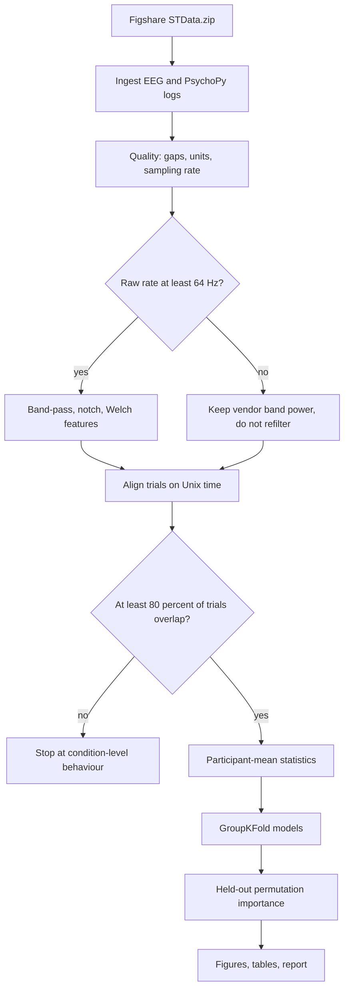

# EEG-based modelling of nonverbal cognitive performance during mental rotation

This repository tests whether four-channel EEG, recorded while people solved mental-rotation items, contains information about two observable outcomes: whether the response was correct, and how long it took.

It does not decode thoughts, and it does not reconstruct the rotation. A model that predicts an outcome is not a model of the reasoning that produced it.

The recordings were collected and published by other researchers. This code analyses that public dataset. It does not claim to have recorded anyone.

## Background

Mental rotation is a nonverbal spatial task: two objects are shown, and the person decides whether they are the same shape under a rotation (Shepard & Metzler, 1971). Ashwin et al. (2025) published EEG, physiology and task logs from 38 post-graduate students who did this task under three conditions. The scientific question taken up here is narrower than the dataset's full scope:

**Can EEG features computed before the response predict accuracy and response time for a participant the model has not seen?**

The questions, the published protocol, and the analysis decisions are in `docs/`.

## Dataset

Ashwin T. S. et al. (2025). *A Multisensor Dataset of South Asian Post-Graduate Students Working on Mental Rotation Tasks.* Scientific Data. https://doi.org/10.1038/s41597-025-04865-5

Data: https://doi.org/10.6084/m9.figshare.28120670 (CC0)

Reported, and checked against the paper rather than assumed in the models:

- 38 participants (22 men, 16 women).
- Muse headband, electrodes AF7, AF8, TP9, TP10.
- Mind Monitor CSV with raw EEG, vendor band power, signal-quality and motion columns.
- PsychoPy logs with condition, difficulty, verdict and response time.
- Three conditions: no time limit and no feedback; no time limit with feedback; time limit and no feedback.

Not stated in the paper, and therefore measured from the files before any spectrum is computed:

- The timestamp grid. In this archive the median interval is about 1 ms, but gaps are much longer, so the file is not analysed as a 1000 Hz recording.
- Timestamp unit. `UnixTime` is in seconds.
- Response-time unit. It is converted to seconds only when it matches the routine duration. The modelled trials are those for which that check succeeded.
- Numeric meaning of the HSI quality columns. Counts are saved. Values are not labelled good or bad.

The archive is about 1.1 GB compressed. It is not committed. See `data/README.md`.

## Architecture



## Install

```bash
pip install -r requirements.txt
```

## Run

```bash
python scripts/download_data.py
python scripts/validate_dataset.py
python scripts/run_pipeline.py
python scripts/generate_report.py
pytest -q
```

A short run on the first two participant folders, once the archive is present:

```bash
python scripts/run_pipeline.py --max-participants 2
```

`run_pipeline.py` writes `results/tables/`, `results/figures/` and `results/reports/research_report.md`. If the archive is absent it writes a status of `no_data` and does not invent scores.

## Methods, in short

- Windows run from trial onset to the response, so feedback in condition 2 is outside the features used to predict that response.
- Trials from one person stay in one side of every train/test split (`GroupKFold`).
- The EEG model is compared with a difficulty-and-condition model and with a dummy model.
- Statistics use one summary per participant, not one row per trial.
- Full decisions: `docs/methodology.md`.

## Results

These numbers are the pipeline output in `results/tables/` and `results/reports/research_report.md`. They are not a claim that EEG decodes mental rotation.

The archive MD5 matches the Figshare record (`bd7fe98a9922077d0229ac52b69a2346`). Each EEG table has 41 columns, including `UnixTime` (seconds) and `QuestionKey`, which matches the PsychoPy trial key. The median timestamp interval is about 1 ms, but the 95th percentile interval is about 20–27 times longer, and the rows are not in time order. That is an irregular merged export. Welch spectra and raw filtering were not used as model features. Features are the mean vendor band power inside the response window.

36 of 38 participants had at least 80% of trials inside the EEG recording (mean coverage 0.94). Participants 10 and 31 did not, and they are excluded from the models. Sample items are excluded. The modelled classification table has 1,113 trials from 36 participants, of which 843 were correct and 270 were incorrect.

Participant-independent `GroupKFold` (5 folds):

| Features | Best classification balanced accuracy | Best regression MAE |
|---|---|---|
| EEG vendor bands | 0.538 (SVM; dummy 0.500) | 9.98 s (SVR; dummy 10.42 s) |
| Condition and difficulty only | 0.672 (logistic) | 8.22 s (SVR) |
| Both | 0.654 (logistic) | 8.68 s (random forest) |

EEG balanced accuracy stays near 0.50. The random-forest accuracy of about 0.75 is the majority class: the pooled confusion matrix is 3 true incorrect predictions and 267 incorrect responses predicted as correct. Adding EEG to the metadata model does not improve it. Response-time error with EEG alone is close to predicting the median time. The metadata model does better because difficulty and the time-limit condition are properties of the item.

Permutation importance on the held-out EEG forest changes balanced accuracy by about 0.001. That is the size expected from a model at chance. It is not evidence for a frequency band or a channel.

Of 36 participant-level tests, one survives Benjamini–Hochberg at 0.05: theta power at TP9 differs across the three conditions (Friedman statistic 15.3, 35 complete participants, FDR-adjusted p = 0.017). The participant-mean vendor values are 0.59, 0.63 and 0.67 in conditions 1, 2 and 3, in the units stored by the file. The paper does not define those units. The difference is an association with condition, not a demonstration of a rotation mechanism.

Figures are in `results/figures/`. A power spectrum is not among them, because the export is not a uniform series.

## Limitations

38 participants, four dry electrodes, an irregular EEG export, two recordings that do not cover the task, class imbalance, and a real difference between predicting a button press and explaining a spatial strategy. Detail: `docs/limitations.md`.

## Layout

```
configs/default.yaml          analysis decisions
src/eeg_mental_rotation/      library
scripts/                      download, validate, run, report
tests/                        synthetic-data tests, including a leakage test
notebooks/                    calls into the library
docs/                         protocol, questions, dictionary, proposed study
results/                      generated, not authored
```

## Attribution

Metadata and recordings: Ashwin et al., as cited above and in `CITATION.cff`. Code in this repository is MIT. The data remain under the publishers' CC0 terms.
